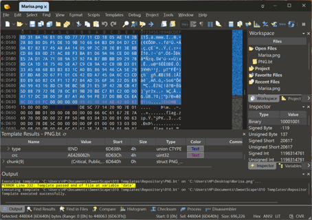

# 魔理沙偷走了重要的东西 - WriteUp  
> 本题考察十六进制分析、PNG格式、ZIP格式、ZIP头修复等知识  

### omake ~ 背景  
“这个可恶的魔理沙，真会添麻烦！”  
我是博丽灵梦，博丽神社的巫女，负责维护幻想乡秩序的和平。  
  
然而，最近一种来自外界的神秘物品出现在了幻想乡，并且拥有着不同寻常的力量，我们暂且将它命名为*flag*。  
为了防止异变发生，我将这个*flag*放在了神社里。  
魔理沙是我最好的朋友，但她有个经常~~偷~~借东西的坏毛病。这次，她趁我出门解决其他异变时“借”走了*flag*，说是要研究魔法。  
我自然不会允许这么危险的东西流入其他地方，然而魔理沙只留下了一张纸条，我必须从这个纸条中找到线索。  

### Stage 1 ~ 纸条的本质  
我拿起纸条仔细端详，但这个纸条却格外地重。  
“这真的只是个字条吗？” 我疑惑着。这张纸大抵是被施加了某种魔法，使它表面上看起来只是个纸条。  
我首先来到红魔馆，让帕秋莉帮我分析了这个字条。  
“这张纸确实不是看到的那样，我使用最近新学的**hex**魔法查看了它，发现它的前半部分符合[**PNG结构**](https://www.cnblogs.com/senior-engineer/p/9548347.html)，这是一个典型的图像；  
后半部分则混杂着一些其他数据，重要的信息应该就藏在这里了。”  
帕秋莉施展了一个**切分**魔法，将图像和后面的数据分隔开来。  
刹那间，这张纸条变成了两个物品：一个**重量很正常的**纸条，还有一个铁盒子。  

### Stage 2 ~ 盒子的分析  
说来也怪，这个铁盒子上没有一个可以打开盒子的开关。  
**灵符「梦想封印」**  
我对着盒子放了张符卡，没能炸开盒子，但炸掉了一小块铁皮，`flag.zip`的字样显露出来。  
“这么怪异的盒子，还是拿去香霖堂看看吧。”  
  
霖之助：“emmm，这个盒子**很像**我之前研究过的一种容器。这种容器很神奇，可以将装进去的东西缩小，能放下很多物品。”  
“在对这个容器细致研究过后，我发现容器分为三部分：**头、中、尾**，并且这三部分各有一块**特殊区域**，用来记录相关的信息。”  
“我将这种容器叫作**ZIP**，将这种结构称为[**ZIP结构**](https://www.cnblogs.com/li-sx/p/17531186.html)”  

### Stage 3 ~ **ZIP**的秘密  

