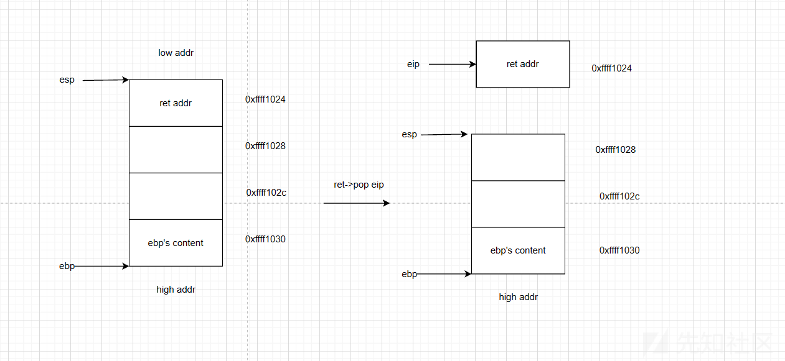

# 自助打印机 - WriteUp  
> 本题知识点：  
> 基本ROP链的构造  
> 栈迁移  

## 初步检查  
拿到手先**checksec**一下：  
```bash
$ checksec --file=printer_queue
RELRO           STACK CANARY      NX            PIE             RPATH      RUNPATH      Symbols         FORTIFY Fortified       Fortifiable     FILE
Partial RELRO   Canary found      NX enabled    No PIE          No RPATH   No RUNPATH   2004 Symbols      No    0               0               printer_queue
```  
**PIE**没开，可能是**ROP**相关的解法。  

反编译一下，发现代码的逻辑如下：  
1. 读取2个字节作为长度 $len$（小端序）  
2. 读取 $len$ 字节，存入 **.bss** 段的 $printer\_queue$ 中  
3. 调用`confirm_print_job`：读取 $40$ 字节，存在栈帧上的 $16$ 字节变量中（`rbp-10h`）  

以上过程中**没有**canary检查机制。  

## 漏洞分析  
容易发现，`confirm_print_job`读取时溢出了 $\text{0x18}$ 字节，能容纳 $3$ 条 **gadget**。  

通过反编译发现该程序采用静态链接，**没有**直接的后门函数，也没有`system`和`execve`等 **ret2libc** 常用后门函数，应该是**ret2syscall**。  

**ROPgadget**过程省略，以下列出了需要的 **gadgets** ：  
|地址|gadget|
|-|-|
|$\texttt{0x401876}$|$\texttt{leave; ret}$|
|$\texttt{0x42149b}$|$\texttt{pop rax; ret}$|
|$\texttt{0x432e48}$|$\texttt{pop rdi; ret}$|
|$\texttt{0x402b86}$|$\texttt{pop rsi; ret}$|
|$\texttt{0x471a77}$|$\texttt{pop rbx; ret}$|
|$\texttt{0x41f83b}$|$\texttt{mov rdx, rbx; syscall}$|

## 栈迁移  
### 引入
然而，这么多的 **gadgets** 显然是放不下的。  

还记得刚开始的输入吗？最多可以输 $\text{0x400}$ 个字节进去。如果可以用来存放 **gadgets** 就好了。  

这时候，就要利用**栈迁移**的手段了。  

### `leave`指令与调用约定  
#### 调用约定  
篇幅较长，不在此过多赘述，请移步至 [x86_64 汇编语言教程 - 子程序与调用约定](https://x86-64-assembly.readthedocs.io/zh-cn/latest/chapter_04_subroutines/index.html) 学习。  

#### `leave`指令与函数尾声
在函数主体执行完毕后，函数有义务恢复至调用前的栈帧，这就是函数尾声的作用。  

函数尾声一般由两条指令组成：  
```asm
leave   // 恢复栈帧
ret     // 跳转回caller
```  
这里的`leave`实际上等价于两条指令：  
```asm
mov rsp, rbp    // 回收分配的栈帧
pop rbp         // 恢复至旧rbp，此时rsp指向call压入的返回地址
```  
有时也会把`leave`直接展开为这两条指令写出。  

图解 `leave`
  

图解 `ret`
  

### 栈迁移  
`leave`在恢复栈帧后，栈顶指针`rsp`会移至`rbp+8h`的位置，而`rbp`会移至栈帧里存储的**旧rbp地址**处。于是，我们可以通过 $2$ 次`leave; ret` **gadget** 来将`rsp`移到指定位置。  

第一次：将`rbp`移至目标地址  
第二次：将`rsp`移至`rbp+8`处  

> :warning: 注意这里的 **+8**，我第一次就漏掉导致了段错误  

## 解题