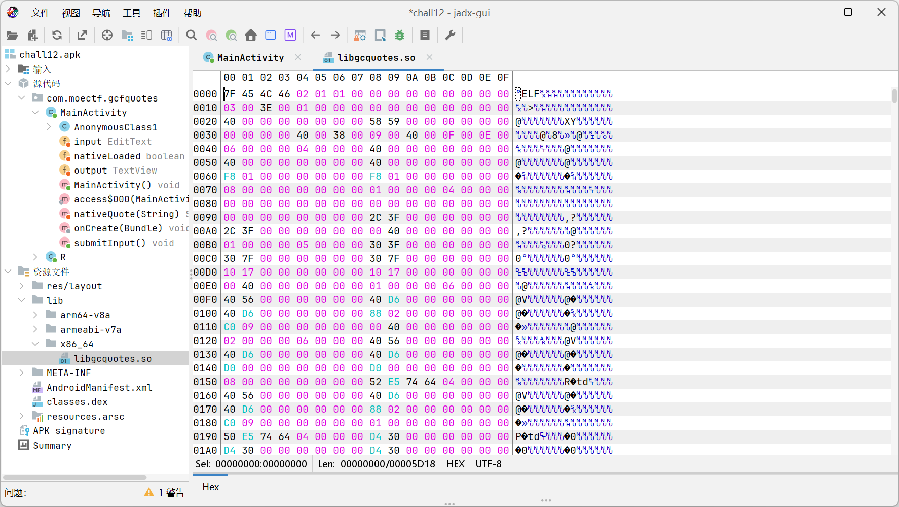
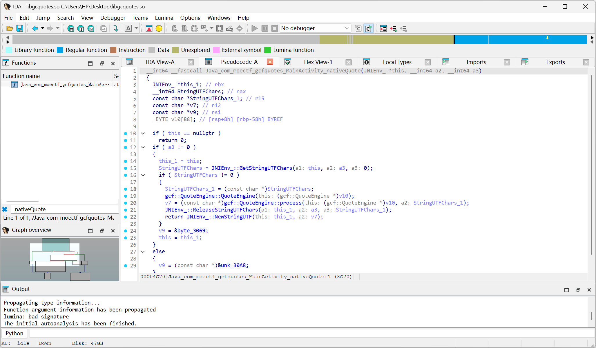
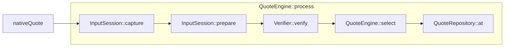
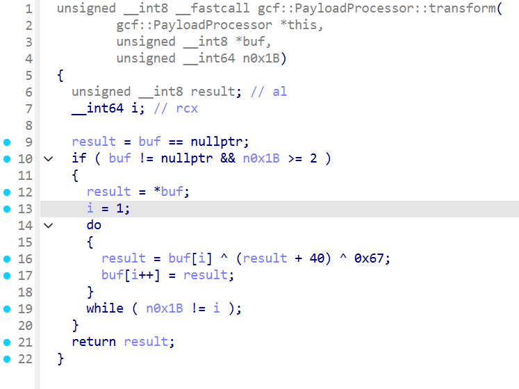

# 广晨风语录 - WriteUp

> 本题知识点：  
> :star::star: APK 逆向分析  
> :star::star: Java 代码阅读能力  
> :star::star::star::star::star: 动态链接库逆向分析  
> :star::star::star::star::star: 数据流追踪能力  
> :star::star::star: 流密码
>
> 综合难度： :star::star::star::star::star::star:

## APK 逆向分析

将 APK 扔进 jadx 反编译，直接查看主类的代码：

```java
package com.moectf.gcfquotes;

import android.app.Activity;
import android.os.Bundle;
import android.view.View;
import android.widget.Button;
import android.widget.EditText;
import android.widget.TextView;

/* JADX INFO: loaded from: classes.dex */
public class MainActivity extends Activity {
    private EditText input;
    private boolean nativeLoaded;
    private TextView output;

    private native String nativeQuote(String str);

    @Override // android.app.Activity
    protected void onCreate(Bundle bundle) {
        super.onCreate(bundle);
        setContentView(R.layout.activity_main);
        this.input = (EditText) findViewById(R.id.input);
        this.output = (TextView) findViewById(R.id.output);
        ((Button) findViewById(R.id.submit)).setOnClickListener(new View.OnClickListener() { // from class: com.moectf.gcfquotes.MainActivity.1
            @Override // android.view.View.OnClickListener
            public void onClick(View view) {
                MainActivity.this.submitInput();
            }
        });
    }

    /* JADX INFO: Access modifiers changed from: private */
    public void submitInput() {
        if (!this.nativeLoaded) {
            try {
                System.loadLibrary("gcquotes");
                this.nativeLoaded = true;
            } catch (Throwable th) {
                this.output.setText("超市就是大润发");
                return;
            }
        }
        try {
            String strNativeQuote = nativeQuote(this.input.getText().toString());
            if (strNativeQuote != null && strNativeQuote.length() != 0) {
                this.output.setText(strNativeQuote);
                return;
            }
            this.output.setText("电车就是问界");
        } catch (Throwable th2) {
            this.output.setText("手机就是遥遥领先");
        }
    }
}
```

简单阅读后发现，APP 会在提交时加载 `gcquotes` 库，将内容**不加处理**直接传入 native 函数 `nativeQuote` 中。  
因此我们可以将 `gcquotes` 库提取出来，抛开 Java 代码直接分析。



右键导出即可。

## 动态链接库逆向分析

将导出的 `libgcquotes.so` 扔进 IDA Pro 里反编译后，追踪数据流。

数据是从 Java 中的 `nativeQuote` 开始流动的，追踪一下这个函数。



可以看到，数据流向了 20 行的 `gcf::QuoteEngine::process` 中。

继续追踪下去，就能总结出一个数据流向图。



对这些函数进行分析，可以理解它们对数据产生的作用：

|函数|作用|
|-|-|
|capture|拷贝|
|prepare|篡改首字节（异或 0xAA）|
|verify|判定|
|select|取 quote 下标|
|at|返回 quote 字符串|

### 分析 verify

深入研究 `verify` ，发现核心就是一个逻辑：

```cpp
this->transform(input) 与 0x3020 处前 27 个字节是否相等 
```

0x3020 提取出的数据如下：

```assembly
.rodata:0000000000003020 byte_3020       db 0C7h, 0E7h, 0Dh, 31h, 4Ah, 73h, 87h, 8Dh, 0B3h, 89h
.rodata:000000000000302A                 db 0AFh, 0EFh, 44h, 65h, 8Eh, 0A3h, 0C3h, 0E5h, 2Eh, 6Eh
.rodata:0000000000003034                 db 0BFh, 0E1h, 1Ah, 4Ch, 65h, 0D9h, 1Bh, 0
```

即
```
c7 e7 0d 31 4a 73 87 8d b3 89 af ef 44 65 8e a3 c3 e5 2e 6e bf e1 1a 4c 65 d9 1b
```

然后分析 `transform`：



其中 `n0x1B` 恒等于 **0x1B**

把 do-while 循环写成 for，就可以更轻松地看出这是个链式异或流密码

```c
unsigned char a = buf[0];
for (size_t i = 1; i < n; i++) {
    a = (unsigned char)((a + 0x28) ^ 0x67);
    a ^= buf[i];
    buf[i] = a;
}
```

结果就是上面的数据。

### 破解明文

```python
exp = bytes.fromhex('c7e70d314a73878db389afef44658ea3c3e52e6ebfe11a4c65d91b')

x = bytearray(len(exp))
x[0] = exp[0]                               # transform 不动 buf[0]
for i in range(1, len(exp)):                # 逐字节反推
    t = ((exp[i-1] + 0x28) & 0xff) ^ 0x67   # 用"上一字节的输出"重建密钥
    x[i] = exp[i] ^ t

flag = bytes([x[0] ^ 0xAA]) + x[1:]         # 撤销 prepare() 的首字节异或

print(flag.decode())
```

    moectf{Ea5y_4ndroiD_Nativ3}

拿到 flag！